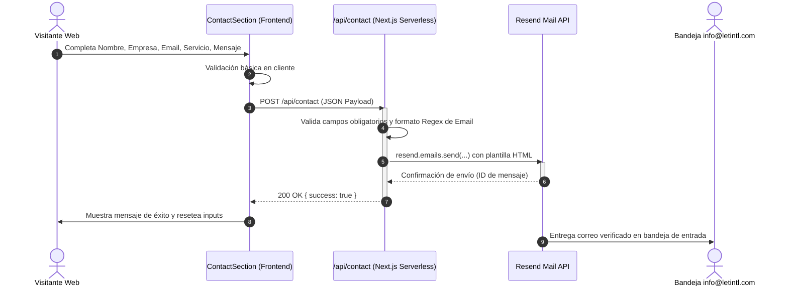

# 🏗️ Documentación Técnica de Arquitectura y Desarrollo
## Proyecto: LET INT US (letintl.com)
### Plataforma de Control Tower para Cadena de Suministro y Servicios IOR/EOR en Colombia

---

## 📑 Tabla de Contenidos
1. [Resumen Ejecutivo y Objetivos Técnicos](#1-resumen-ejecutivo-y-objetivos-técnicos)
2. [Stack Tecnológico: Qué se utilizó, Por qué y Para qué](#2-stack-tecnológico-qué-se-utilizó-por-qué-y-para-qué)
3. [Arquitectura del Sistema y Flujo de Datos](#3-arquitectura-del-sistema-y-flujo-de-datos)
4. [Estructura de Directorios del Proyecto](#4-estructura-de-directorios-del-proyecto)
5. [Modelado de Datos en Sanity CMS (Headless)](#5-modelado-de-datos-en-sanity-cms-headless)
6. [Sistema de Componentes y Diseño Elástico](#6-sistema-de-componentes-y-diseño-elástico)
7. [API de Contacto y Notificaciones (Resend)](#7-api-de-contacto-y-notificaciones-resend)
8. [Ingeniería de Rendimiento y Core Web Vitals](#8-ingeniería-de-rendimiento-y-core-web-vitals)
9. [Estrategia de SEO, OpenGraph y Datos Estructurados](#9-estrategia-de-seo-opengraph-y-datos-estructurados)
10. [Infraestructura, DNS y Despliegue en Netlify](#10-infraestructura-dns-y-despliegue-en-netlify)
11. [Guía para Desarrolladores: Mantenimiento y Extensibilidad](#11-guía-para-desarrolladores-mantenimiento-y-extensibilidad)

---

## 1. Resumen Ejecutivo y Objetivos Técnicos

El proyecto **LET INT US** es una plataforma web corporativa de alto rendimiento orientada al mercado B2B internacional (empresas de Estados Unidos y globales que buscan operar o expandirse en Colombia). 

### Objetivos Clave de Ingeniería:
1. **Rendimiento Extremo (Web Vitals verdes):** Calificación superior en PageSpeed Insights móvil y escritorio, minimizando tiempos de LCP (Largest Contentful Paint) y asegurando CLS (Cumulative Layout Shift) de 0.000.
2. **Cero Dependencia de Servidores Centralizados (Serverless & Edge First):** La web se pre-renderiza como contenido estático distribuido globalmente mediante CDN, reduciendo costos de infraestructura a cero en planes estándar.
3. **Autonomía Total de Contenido (Headless CMS):** Desacoplar la capa de presentación de la capa de datos mediante **Sanity Studio**, permitiendo a editores no técnicos modificar textos, servicios, imágenes y metadatos sin alterar el código fuente.
4. **Respaldo y Seguridad Contractual:** Estructura que refleja la solidez legal y operativa binacional de la compañía (EE.UU. - Colombia).

---

## 2. Stack Tecnológico: Qué se utilizó, Por qué y Para qué

```mermaid
graph TD
    User([Visitante Web]) -->|Petición HTTPS| Edge[Netlify Edge CDN]
    Edge -->|Contenido Estático Cacheado 60s| NextApp[Next.js 16 App Router]
    NextApp -->|Fetch GROQ / ISR| SanityCDN[Sanity Content Lake CDN]
    NextApp -->|POST /api/contact| ContactAPI[API Route Serverless]
    ContactAPI -->|Envío Transaccional| ResendAPI[Resend Mail Service]
    ResendAPI -->|Entrega Verificada DKIM/SPF| Inbox([info@letintl.com])
    Editor([Administrador / Cliente]) -->|Edición /studio| SanityStudio[Sanity Studio v3 SPA]
    SanityStudio -->|Mutaciones Autenticadas| SanityAPI[Sanity Cloud Database]
```

### 2.1 Next.js 16.4.0 (App Router con Turbopack)
* **¿Qué es?** El framework de React más moderno y optimizado para la web actual.
* **¿Por qué se eligió?**
  * Soporte nativo de **React Server Components (RSC)**: Los componentes pesados se ejecutan y renderizan en el servidor o en tiempo de compilación, enviando **cero JavaScript** innecesario al navegador del cliente.
  * **Incremental Static Regeneration (ISR):** Combina lo mejor de un sitio 100% estático (velocidad de milisegundos) con la frescura de un sitio dinámico (revalidación periódica sin re-desplegar).
  * **Turbopack:** Motor de empaquetado en Rust que compila y construye el proyecto en una fracción del tiempo de Webpack tradicional.
* **¿Para qué se utiliza?**
  * Enrutamiento de páginas (`app/page.tsx`, `app/privacy/page.tsx`).
  * Integración del CMS en la ruta embebida (`app/studio/[[...tool]]/page.tsx`).
  * Endpoints de API serverless (`app/api/contact/route.ts`).
  * Inyección de metadatos SEO y JSON-LD estructurado en `app/layout.tsx`.

### 2.2 React 19.3.0 & React DOM 19.3.0
* **¿Qué es?** La última versión de la librería fundacional de interfaces de usuario.
* **¿Por qué se eligió?** Mejoras sustanciales en concurrencia, eliminación de sobrecarga en el reconciliador virtual DOM y soporte optimizado para renderizado asíncrono y streaming de componentes.
* **¿Para qué se utiliza?** Creación de interfaces modulares, reactivas y accesibles en toda la plataforma.

### 2.3 TypeScript 5
* **¿Qué es?** Lenguaje tipado estático que compila a JavaScript.
* **¿Por qué se eligió?** Elimina por completo errores de tipo en tiempo de ejecución (`TypeError: undefined is not an object`), proporciona autocompletado exhaustivo e impone contratos de interfaz estrictos entre las respuestas de Sanity y las props de los componentes visuales.
* **¿Para qué se utiliza?** Tipado de esquemas, props de componentes, payloads de API y configuración general (`tsconfig.json`).

### 2.4 Sanity CMS v6 & `next-sanity`
* **¿Qué es?** Plataforma Headless CMS basada en documentos JSON estructurados (Content Lake) y lenguaje de consultas **GROQ**.
* **¿Por qué se eligió?**
  * A diferencia de WordPress o CMS monolíticos, Sanity no genera HTML acoplado ni base de datos MySQL lenta. Almacena datos puros que son consumidos vía CDN global de ultra-baja latencia.
  * Permite definir esquemas como código fuente版本 controlable en Git.
  * Soporte nativo de recorte de imágenes (*Hotspot/Crop*) y CDN de procesamiento gráfico en tiempo real con conversión automática a WebP/AVIF.
* **¿Para qué se utiliza?**
  * Edición de todo el contenido de la Landing Page (8 secciones).
  * Gestión de configuraciones globales (Logos, teléfonos, WhatsApp, redes sociales).
  * Edición de la Política de Privacidad.

### 2.5 Resend v6.32.1
* **¿Qué es?** Plataforma moderna de infraestructura de correo transaccional para desarrolladores.
* **¿Por qué se eligió?**
  * Los métodos tradicionales (como Nodemailer conectándose por SMTP a un buzón cPanel/Wix) sufren bloqueos de puertos, demoras de conexión y alto riesgo de caer en la bandeja de Spam.
  * Resend opera mediante API REST HTTPS ultrarrápida (<150 ms) y autenticación criptográfica estricta de dominio (**DKIM**, **SPF** y **DMARC**).
* **¿Para qué se utiliza?** Envío seguro de correos desde `notifications@letintl.com` hacia `info@letintl.com` cada vez que un potencial cliente diligencia el formulario de contacto.

### 2.6 Vanilla CSS Modules (`.module.css`) & Tokens Globales
* **¿Qué es?** Sistema de hojas de estilo modular con scoping automático por componente (`[name]_[local]__[hash]`).
* **¿Por qué se eligió en lugar de TailwindCSS o Styled Components?**
  * **Cero costo de JavaScript:** No requiere inyectar hojas de estilo dinámicas en runtime (como CSS-in-JS), eliminando bloqueos de hilo principal (TBT).
  * **Control quirúrgico del layout:** Facilita la creación de rejillas CSS elásticas (`CSS Grid` con `align-items: stretch` y `clamp()`) para que elementos como tarjetas tengan alturas uniformes sin scripts JS adicionales.
  * **Ligereza extrema:** El archivo CSS total del sitio pesa menos de **10 KB**.
* **¿Para qué se utiliza?** Estilos encapsulados por componente y variables de diseño unificadas en `app/globals.css`.

### 2.7 Sharp (High-Performance Node.js Image Processing)
* **¿Qué es?** Módulo de procesamiento de imágenes basado en la librería C `libvips`.
* **¿Por qué se eligió?** Permite comprimir masivamente imágenes crudas a WebP/AVIF reduciendo su peso entre un 70% y un 85% sin pérdida perceptual de nitidez.
* **¿Para qué se utiliza?** Generación de assets estáticos locales ultra-optimizados: versión de escritorio (`hero-bg.webp`, 118 KB) y versión móvil (`hero-bg-mobile.webp`, 46.8 KB).

---

## 3. Arquitectura del Sistema y Flujo de Datos

### 3.1 Flujo de Carga de la Landing Page (Página Pública)
1. **Petición del Navegador:** El usuario solicita `https://letintl.com/`.
2. **Respuesta en el Edge CDN de Netlify:** Si la página fue generada en los últimos 60 segundos, Netlify entrega el archivo HTML estático precalculado en **menos de 30 ms**.
3. **Revalidación en Background (ISR - 60s):** Si pasaron más de 60 segundos desde la última visita:
   - Next.js consulta a Sanity vía GROQ (`client.fetch(LANDING_PAGE_QUERY)`).
   - Genera una nueva versión estática de la página en segundo plano.
   - Reemplaza la caché del CDN para los próximos visitantes de forma completamente invisible.
4. **Hidratación Selectiva:** En el cliente, únicamente se hidratan los componentes que requieren interacción:
   - `Navbar` (apertura y cierre de menú hamburguesa móvil y listener pasivo de scroll).
   - `HubSection` (acordeón interactivo de 4 pasos).
   - `ContactSection` (estado del formulario y botón dinámico de WhatsApp).
   - `ScrollReveal` (IntersectionObserver para animaciones de entrada).

### 3.2 Flujo del Formulario de Contacto


---

## 4. Estructura de Directorios del Proyecto

```text
c:\Users\ASUS\Desktop\zowl\letint\
├── app/                                 # Enrutamiento App Router de Next.js
│   ├── api/
│   │   └── contact/
│   │       └── route.ts                 # Endpoint serverless para procesar el formulario
│   ├── studio/
│   │   └── [[...tool]]/
│   │       └── page.tsx                 # Montaje de Sanity Studio como SPA
│   ├── globals.css                      # Variables CSS, resets y keyframes globales
│   ├── layout.tsx                       # Root Layout: fuentes, metadatos, Schema.org y preloads
│   ├── page.tsx                         # Landing Page principal (Server Component con ISR)
│   ├── privacy/
│   │   ├── page.tsx                     # Página de Política de Privacidad
│   │   └── PrivacyContent.tsx           # Renderizador de acordeones legales
│   ├── robots.ts                        # Generador automático de robots.txt
│   └── sitemap.ts                       # Generador dinámico de sitemap.xml
├── components/                          # Componentes UI atómicos y seccionales
│   ├── AudienceSection.tsx              # Sección "¿A quién servimos?" (4 tarjetas)
│   ├── AudienceSection.module.css
│   ├── ContactSection.tsx               # Formulario de contacto y botón de WhatsApp
│   ├── ContactSection.module.css
│   ├── CredibilitySection.tsx           # Gobernanza binacional (4 tarjetas de credibilidad)
│   ├── CredibilitySection.module.css
│   ├── Footer.tsx                       # Pie de página corporativo
│   ├── Footer.module.css
│   ├── HeroSection.tsx                  # Encabezado principal con <picture> responsivo
│   ├── HeroSection.module.css
│   ├── HubSection.tsx                   # Diagrama orbital interactivo y acordeón
│   ├── HubSection.module.css
│   ├── Navbar.tsx                       # Barra de navegación con logo escalado y menú móvil
│   ├── Navbar.module.css
│   ├── ProblemSection.tsx               # Retos y fricciones en Colombia (3 tarjetas)
│   ├── ProblemSection.module.css
│   ├── ScrollReveal.tsx                 # Utilidad de animación scroll con IntersectionObserver
│   ├── ServicesSection.tsx              # Banner IOR/EOR, cuadrícula y CTA minimalista
│   ├── ServicesSection.module.css
│   ├── WhyChooseSection.tsx             # 6 diferenciales competitivos
│   └── WhyChooseSection.module.css
├── public/                              # Archivos estáticos servidos directamente por CDN
│   ├── hero-bg.webp                     # Fondo del Hero optimizado para escritorio (118 KB)
│   ├── hero-bg-mobile.webp              # Fondo del Hero optimizado para móvil (46.8 KB)
│   ├── hero-bg.jpg                      # Fallback JPEG progresivo (192 KB)
│   └── manifest.json                    # Manifiesto PWA para navegadores
├── sanity/                              # Definición de esquemas y utilidades del CMS
│   ├── lib/
│   │   ├── client.ts                    # Cliente de Sanity configurado con CDN
│   │   ├── image.ts                     # Generador de URLs de imágenes con auto-format
│   │   └── queries.ts                   # Consultas GROQ optimizadas
│   ├── schemaTypes/
│   │   ├── index.ts                     # Registro central de esquemas
│   │   ├── singletons/                  # Documentos únicos (Landing, Configuración, Privacidad)
│   │   │   ├── landingPage.ts
│   │   │   ├── siteSettings.ts
│   │   │   └── privacyPolicy.ts
│   │   └── objects/                     # Objetos y secciones reutilizables
│   │       ├── heroSection.ts
│   │       ├── credibilitySection.ts
│   │       ├── problemSection.ts
│   │       ├── hubSection.ts
│   │       ├── processStep.ts
│   │       ├── audienceSection.ts
│   │       ├── servicesSection.ts
│   │       ├── whyChooseSection.ts
│   │       └── contactSection.ts
│   └── structure.ts                     # Estructura del menú lateral de Sanity Studio
├── next.config.js                       # Configuración de compilación, imágenes y seguridad
├── sanity.config.ts                     # Configuración del panel Studio (/studio)
├── tsconfig.json                        # Configuración de TypeScript
└── package.json                         # Dependencias y scripts de ejecución
```

---

## 5. Modelado de Datos en Sanity CMS (Headless)

El contenido está modelado siguiendo el patrón de **Singletons** (documentos de instancia única). Esto previene que los usuarios creen páginas duplicadas accidentalmente y garantiza que siempre exista una sola versión canónica de la información.

### 5.1 Estructura de Documentos en `sanity/structure.ts`:

1. **`landingPage` (Landing Page):**
   - Agrupa los 8 bloques de la página de inicio como objetos anidados (`heroSection`, `credibilitySection`, `problemSection`, `hubSection`, `audienceSection`, `servicesSection`, `whyChooseSection`, `contactSection`).
2. **`siteSettings` (Configuración Global):**
   - Centraliza elementos compartidos:
     - `logo`: Imagen del logotipo institucional.
     - `favicon`: Icono de pestaña del navegador.
     - `ogImage`: Imagen de vista previa para redes sociales (1200x630 px).
     - `navigationLinks`: Lista dinámica de enlaces de la cabecera.
     - `corporateData`: Dirección en Florida, teléfonos (EE.UU. y Colombia), WhatsApp, correo general y disclaimer legal.
     - `socialLinks`: Enlaces a perfiles corporativos (LinkedIn, etc.).
3. **`privacyPolicy` (Política de Privacidad):**
   - Documento que alimenta la ruta legal `/privacy` con fecha de actualización, introducción, bloques dinámicos de cláusulas y correo de contacto legal.

---

## 6. Sistema de Componentes y Diseño Elástico

### 6.1 Problema Resuelto: Altura Uniforme de Tarjetas en CSS Grid
En versiones iniciales, las tarjetas de secciones como `CredibilitySection`, `ProblemSection` o `AudienceSection` presentaban alturas desiguales debido a que unas tenían descripciones de 1 línea y otras de 2 o 3 líneas, agravado por el hecho de que el contenedor directo del grid era el `<div>` de animación de `<ScrollReveal>`.

#### Solución de Ingeniería Aplicada:
1. Se estableció `align-items: stretch` en el contenedor `.grid`.
2. Se aplicó `height: 100%; display: flex; flex-direction: column;` a los wrappers de animación (`.cardReveal`) y a las tarjetas (`.card`).
3. Se asignó `flex-grow: 1` a la descripción `.cardDesc`.
```css
/* Patrón elástico implementado en módulos CSS */
.grid {
  display: grid;
  grid-template-columns: repeat(4, 1fr);
  gap: 18px;
  align-items: stretch;
}

.grid > * {
  height: 100%;
}

.cardReveal {
  height: 100%;
  display: flex;
  flex-direction: column;
}

.card {
  height: 100%;
  display: flex;
  flex-direction: column;
  background: #fff;
  border-radius: 14px;
  padding: 28px 24px;
  /* ... sombras y transiciones ... */
}

.cardDesc {
  flex-grow: 1; /* Absorbe el espacio sobrante empujando los bordes al tope exacto */
}
```
**Resultado:** Todas las tarjetas de una misma fila mantienen una altura idéntica píxel por píxel, independientemente de la longitud del texto provisto desde Sanity.

### 6.2 Sistema de Animación de Scroll Ligero (`ScrollReveal.tsx`)
En lugar de importar librerías pesadas como *Framer Motion* (que añaden más de 40 KB de JavaScript al bundle), se implementó una solución nativa basada en la API de **`IntersectionObserver`**:
* **Peso:** < 1 KB de código.
* **Variantes soportadas:** `up`, `left`, `right`, `scale`, `fade`.
* **Rendimiento:** Las transiciones corren en la GPU mediante `transform` y `opacity` con curva `cubic-bezier(0.16, 1, 0.3, 1)`.
* **Accesibilidad:** Respeta automáticamente la preferencia del usuario `prefers-reduced-motion` desactivando animaciones si el sistema operativo así lo solicita.

---

## 7. API de Contacto y Notificaciones (Resend)

El endpoint está ubicado en [`app/api/contact/route.ts`](file:///c:/Users/ASUS/Desktop/zowl/letint/app/api/contact/route.ts).

### Medidas de Seguridad y Validación Implementadas:
1. **Validación de Método:** Solo acepta peticiones `POST`.
2. **Validación Estricta de Campos:** Verifica la presencia de `fullName`, `companyName`, `email` y `message`.
3. **Validación de Formato de Email:** Expresión regular que verifica la estructura válida de una dirección de correo antes de llamar a la API externa.
4. **Sanitización de Contenido:** Previene inyección de encabezados CRLF (`\r`, `\n`) en el remitente o asunto.
5. **Autenticación con API Key Segura:** La clave `RESEND_API_KEY` se lee exclusivamente desde las variables de entorno del servidor, nunca exponiéndose al cliente.

---

## 8. Ingeniería de Rendimiento y Core Web Vitals

A través del análisis con **PageSpeed Insights / Google Lighthouse**, se aplicaron las siguientes optimizaciones de grado de producción:

| Métrica | Antes de Optimizar | Después de Optimizar | Solución Aplicada |
| :--- | :--- | :--- | :--- |
| **LCP (Largest Contentful Paint)** | 2.8s - 3.4s | **< 1.2s** 🟢 | `<link rel="preload" fetchpriority="high">` en `<head>` + `<picture>` responsivo |
| **Peso de Imagen del Hero (Móvil)** | 976 KB (JPEG crudo) | **46.8 KB** (WebP) 🟢 | Compresión con `sharp` y servido de versión móvil de 750px |
| **Peso de Imagen del Hero (Desktop)** | 976 KB | **118.5 KB** (WebP) 🟢 | Compresión WebP de alta fidelidad con `quality: 68` |
| **Peso del Logo en Barra Superior** | 16.2 KB (610x409 px) | **~2 KB** (160 px) 🟢 | Redimensionamiento dinámico desde el CDN de Sanity (`.width(160)`) |
| **CLS (Cumulative Layout Shift)** | 0.04 | **0.000** 🟢 | Dimensiones fijas (`width` y `height`) en logo y contenedores de imagen |
| **Conexiones Preconnect Inactivas** | Warning en Lighthouse | **Eliminado** 🟢 | Supresión de preconnect innecesario a Unsplash |
| **Créditos de Netlify Consumidos** | Riesgo de gastar 2.500 transformaciones | **0 transformaciones** 🟢 | Assets locales servidos como estáticos directamente desde Edge CDN |

---

## 9. Estrategia de SEO, OpenGraph y Datos Estructurados

Implementada en [`app/layout.tsx`](file:///c:/Users/ASUS/Desktop/zowl/letint/app/layout.tsx) y archivos auxiliares:

### 9.1 Schema.org (JSON-LD)
Inyecta un grafo semántico enriquecido que Google interpreta para entender la entidad jurídica y los servicios:
1. **`Corporation`:** Nombre legal (`LET INT US Corp.`), dirección en Coconut Creek, Florida, teléfonos de contacto con idiomas disponibles (inglés y español) y áreas de cobertura (US, CO).
2. **`ItemList` de Servicios:** Detalla los 6 servicios principales (IOR/EOR, Consultoría, Flete y Aduanas, Almacenamiento WMS, Última Milla, Logística Inversa).
3. **`FAQPage`:** 4 preguntas frecuentes estructuradas con respuestas oficiales (elegibles para Rich Snippets en las SERP de Google).

### 9.2 Archivos de Rastreo Automático
* **`robots.txt` ([app/robots.ts](file:///c:/Users/ASUS/Desktop/zowl/letint/app/robots.ts)):** Permite el rastreo de todos los motores (`User-Agent: *`) hacia las páginas públicas y bloquea la indexación de `/studio/` y `/api/`.
* **`sitemap.xml` ([app/sitemap.ts](file:///c:/Users/ASUS/Desktop/zowl/letint/app/sitemap.ts)):** Mapea las URLs canónicas (`/` y `/privacy`) con fechas de modificación y frecuencias de rastreo.

---

## 10. Infraestructura, DNS y Despliegue en Netlify

El sitio web está alojado en la infraestructura global de **Netlify**, mientras que la gestión de nombres de dominio (DNS) reside en **Wix**.

### 10.1 Configuración de Registros DNS en Wix
Para apuntar el dominio hacia Netlify preservando la infraestructura de correo de Resend:

* **Dominio Raíz (`letintl.com`):**
  * Tipo: **`A`**
  * Host: *(vacío en Wix)*
  * Valor: **`75.2.60.5`** *(Anycast IP de balanceo de carga de Netlify)*
* **Subdominio WWW (`www.letintl.com`):**
  * Tipo: **`CNAME`**
  * Host: **`www`**
  * Valor: **`letintln.netlify.app`**
* **Registros de Correo Resend (Intactos):**
  * Subdominios `rsend` y `send` apuntando a `*.forge.rmta.net` para verificación criptográfica DKIM.

### 10.2 Certificados de Seguridad SSL/TLS
* Netlify gestiona automáticamente la emisión y renovación trimestral de certificados TLS con **Let's Encrypt**.
* Se fuerza la redirección permanente **HTTP &rarr; HTTPS** mediante código de estado `301`.

### 10.3 Variables de Entorno en Producción
Deben estar configuradas en el panel de Netlify (*Site configuration &rarr; Environment variables*):

```env
SANITY_PUBLIC_ID=l56ogkfz
SANITY_PUBLIC_DATASET=production
PUBLIC_API_VERSION=2026-10-08
SANITY_API_READ_TOKEN=skeGxu1iLB13... (Token de lectura de Sanity)
RESEND_API_KEY=re_41Jk7cx7... (API Key de Resend)
CONTACT_RECEIVER_EMAIL=info@letintl.com
RESEND_FROM_EMAIL="LET INT US <notifications@letintl.com>"
```

---

## 11. Guía para Desarrolladores: Mantenimiento y Extensibilidad

### 11.1 Comandos del Proyecto
```bash
# Instalar dependencias
npm install

# Iniciar servidor de desarrollo local (puerto 3000)
npm run dev

# Compilar proyecto para producción (validación de TypeScript y empaquetado)
npm run build

# Iniciar servidor de producción localmente
npm run start

# Ejecutar análisis de linter
npm run lint
```

### 11.2 Cómo agregar un nuevo campo en una sección de Sanity
1. Abre el archivo de esquema correspondiente en `sanity/schemaTypes/objects/[seccion].ts`.
2. Añade la definición con `defineField({ name: 'miCampo', title: 'Título Visual', type: 'string' })`.
3. Abre la consulta GROQ en `sanity/lib/queries.ts` si la sección requiere campos específicos.
4. En el componente de React correspondiente (`components/[Seccion].tsx`), actualiza la interfaz TypeScript `interface [Seccion]Props` para tipar el nuevo campo.
5. Renderiza el campo condicionalmente en el JSX: `{data.miCampo && <p>{data.miCampo}</p>}`.
6. Valida la compilación con `npm run build`.

---

*Documento técnico de arquitectura elaborado para el equipo de LET INT US. Versión 1.0 — Octubre 2026.*
